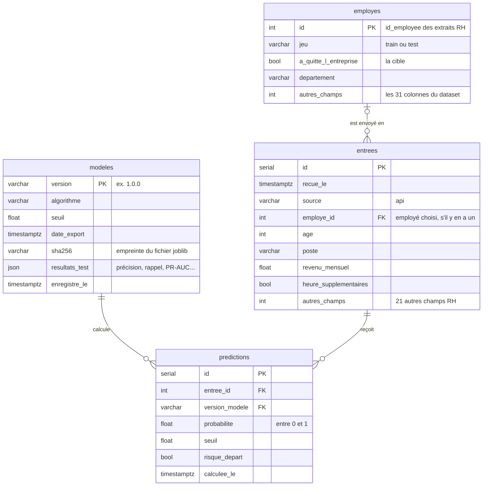

# Base de données

La base contient le dataset complet du projet 4 (1 470 employés) et chaque prédiction
demandée à l'API. Aucune prédiction n'est calculée à l'avance : l'utilisateur choisit un
employé, l'API le fait passer par le modèle, enregistre le résultat et le renvoie. On garde
ainsi la trace de ce que le modèle a dit, sur quelles données et avec quelle version, et on
peut comparer ses alertes aux départs réels.

## Schéma



Le script SQL complet est dans [db/schema.sql](../db/schema.sql). Il est généré à partir de
[src/attrition_api/db.py](../src/attrition_api/db.py), et un test vérifie que les deux
restent identiques.

## Les tables

| Table | Une ligne par | Rôle |
| --- | --- | --- |
| `employes` | employé du dataset | Les trois extraits RH fusionnés, avec la cible et le jeu (`train` ou `test`) du projet 4. |
| `modeles` | version de modèle servie | Ajoutée au démarrage de l'API. Garde le seuil, l'empreinte et les résultats du test. |
| `entrees` | employé envoyé au modèle | Les 25 champs RH validés, avec la date et l'origine de l'envoi. Lien vers `employes` quand l'utilisateur a choisi un employé de la base. |
| `predictions` | calcul d'un modèle sur une entrée | Probabilité, seuil appliqué et alerte. |

## Choix de conception

- **Dataset brut à part.** `employes` garde toutes les colonnes des extraits, y compris
  celles que le modèle ignore (département, heures de travail...). `entrees` ne contient
  que ce que le modèle reçoit. Un employé choisi dans la base et un employé saisi à la
  main sont donc enregistrés de la même façon.
- **Entrées et prédictions séparées.** Une entrée peut recevoir une prédiction par version
  de modèle (contrainte `UNIQUE (entree_id, version_modele)`). Après un nouvel entraînement,
  on peut recalculer l'historique et comparer les deux modèles sur les mêmes employés.
- **Une colonne par champ RH plutôt qu'un JSON.** Les requêtes restent simples
  (`GROUP BY poste`) et PostgreSQL vérifie les types. Les colonnes reprennent les noms du
  schéma de l'API, et un test le vérifie.
- **Seuil copié dans chaque prédiction.** Le seuil d'un modèle ne change pas, mais la ligne
  reste lisible seule, et `risque_depart` peut être vérifié sans jointure.
- **Contrôles dans la base.** La probabilité doit être comprise entre 0 et 1. Les clés
  étrangères empêchent une prédiction sans entrée ou sans modèle connu.
- **Même version, même fichier.** Au démarrage, l'API refuse une version déjà enregistrée
  avec une autre empreinte : un modèle ré-exporté doit changer de version.
- **Une transaction par appel.** L'entrée et sa prédiction sont écrites ensemble. Un appel
  refusé (clé invalide, données invalides) n'écrit rien.
- **Index.** Ils portent sur les colonnes filtrées dans les requêtes d'exemple : date de
  réception, poste, alerte et version.

## Accès

Deux comptes PostgreSQL, chacun avec son mot de passe dans `.env` :

| Compte | Variable | Droits | Utilisé par |
| --- | --- | --- | --- |
| `attrition` | `ADMIN_DATABASE_URL` | Propriétaire de la base | `create_db`, l'import du dataset, `interroger_db.py` |
| `api_attrition` | `DATABASE_URL` | `SELECT` et `INSERT` sur `modeles`, `entrees` et `predictions` ; `SELECT` sur 27 colonnes de `employes` | L'API |

L'API lit dans `employes` l'identifiant, le département et les 25 champs du modèle, grâce
à un droit par colonne. Elle ne peut pas lire le départ réel (`a_quitte_l_entreprise`) ni
le découpage `jeu`. Elle ne peut ni modifier ni supprimer une prédiction, ni créer ou
supprimer une table. Si elle était compromise, elle
ne pourrait pas effacer l'historique. `PUBLIC` perd aussi ses droits par défaut sur la
base. Les instructions `GRANT` sont dans [src/attrition_api/acces.py](../src/attrition_api/acces.py)
et à la fin de [db/schema.sql](../db/schema.sql). Des tests se connectent avec ce rôle
et vérifient chaque refus.

## Créer la base et importer le dataset

```bash
docker compose up -d db
uv run python -m attrition_api.create_db --roles      # tables, rôle de l'API et droits
uv run python scripts/importer_dataset.py --source ../technova-attrition
```

`create_db` utilise le compte propriétaire. `--roles` crée `api_attrition` avec le mot de
passe `API_DB_PASSWORD`, ou le met à jour. `--reinitialiser` supprime puis recrée les
tables. `--sql` affiche le script SQL sans l'exécuter. Avec `docker compose up`, le service
`init-db` lance `create_db --roles` avant l'API.

L'import lit les trois CSV du projet 4 et prend la liste du jeu de test dans son artefact
(`artefacts/modele_final.joblib`), qui restent hors de Git. Il insère les 1 470 employés,
sans aucune prédiction. On peut le relancer : il met les employés à jour et garde les
prédictions déjà faites.

## Prédire un employé de la base

```bash
curl "http://127.0.0.1:8000/employes?departement=Commercial&limite=5" -H "X-API-Key: $API_KEY"
curl -X POST http://127.0.0.1:8000/employes/478/predictions -H "X-API-Key: $API_KEY"
```

L'API lit la fiche de l'employé, la valide avec le même schéma que `POST /predictions`,
calcule la probabilité, puis enregistre l'entrée (avec `employe_id`) et la prédiction.
Chaque appel donne une nouvelle prédiction, datée.

`performances_test` compare ensuite, en SQL, les alertes aux départs réels des employés du
jeu de test déjà prédits. Un employé prédit plusieurs fois ne compte qu'une fois. Une fois
les 294 employés du test prédits, on retrouve les résultats du projet 4 : 33 départs
détectés, 64 fausses alertes et 14 départs manqués.

## Requêtes

[db/requetes.sql](../db/requetes.sql) contient des requêtes nommées : synthèse, alertes par
poste, performances sur le test, départs par département... Elles portent sur le dataset
importé et sur les prédictions demandées à l'API.

```bash
uv run python scripts/interroger_db.py --liste
uv run python scripts/interroger_db.py alertes_par_poste
uv run python scripts/interroger_db.py departs_par_departement
uv run python scripts/interroger_db.py export --csv predictions.csv
```

## Données personnelles

Les tables `employes` et `entrees` contiennent des données RH personnelles, dont le genre
et le statut marital. La base ne tourne qu'en local, sur `127.0.0.1`, et l'API ne voit
pas le départ réel des employés. En production, il faudrait aussi fixer une durée de conservation et
pouvoir supprimer un employé. La suppression d'une entrée supprime ses prédictions
(`ON DELETE CASCADE`). Le dataset n'est pas versionné. Seuls trois employés du jeu de test
(478, 734 et 1839) sont dans le dépôt : ils servent d'exemple dans Swagger et de références
dans les tests.
