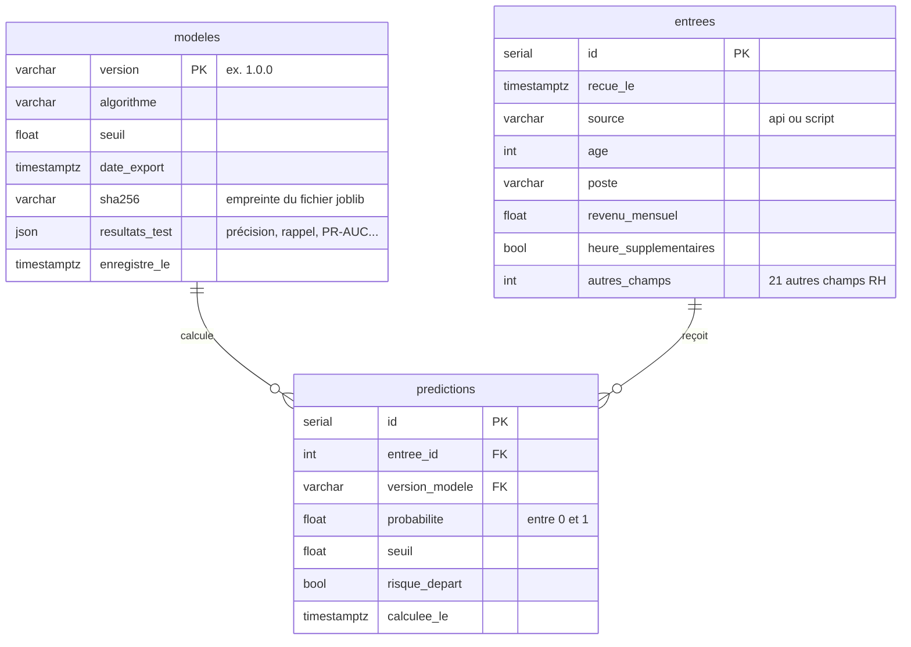

# Base de données

L'API enregistre dans PostgreSQL chaque employé reçu et la prédiction calculée. On garde
ainsi la trace de ce que le modèle a dit, sur quelles données et avec quelle version.

## Schéma



Le script SQL complet est dans [db/schema.sql](../db/schema.sql). Il est généré à partir de
[src/attrition_api/db.py](../src/attrition_api/db.py), et un test vérifie que les deux
restent identiques.

## Les tables

| Table | Une ligne par | Rôle |
| --- | --- | --- |
| `modeles` | version de modèle servie | Ajoutée au démarrage de l'API. Garde le seuil, l'empreinte et les résultats du test. |
| `entrees` | employé reçu | Les 25 champs RH validés par l'API, avec la date et l'origine de l'envoi. |
| `predictions` | calcul d'un modèle sur une entrée | Probabilité, seuil appliqué et alerte. |

## Choix de conception

- **Entrées et prédictions séparées.** Une entrée peut recevoir une prédiction par version
  de modèle (contrainte `UNIQUE (entree_id, version_modele)`). Après un nouvel entraînement,
  on peut recalculer l'historique et comparer les deux modèles sur les mêmes employés.
- **Une colonne par champ RH plutôt qu'un JSON.** Les requêtes restent simples
  (`GROUP BY poste`) et PostgreSQL vérifie les types. Les colonnes reprennent les noms du
  schéma de l'API, et un test le vérifie.
- **Seuil copié dans chaque prédiction.** Le seuil d'un modèle ne change pas, mais la ligne
  reste lisible seule, et `risque_depart` peut être vérifié sans jointure.
- **Contrôles dans la base.** La probabilité doit être comprise entre 0 et 1. Les clés
  étrangères empêchent une prédiction sans entrée ou sans modèle connu.
- **Même version, même fichier.** Au démarrage, l'API refuse une version déjà enregistrée
  avec une autre empreinte : un modèle ré-exporté doit changer de version.
- **Une transaction par appel.** L'entrée et sa prédiction sont écrites ensemble. Un appel
  refusé (clé invalide, données invalides) n'écrit rien.
- **Index.** Ils portent sur les colonnes filtrées dans les requêtes d'exemple : date de
  réception, poste, alerte et version.

## Créer la base

```bash
docker compose up -d db                     # PostgreSQL 17 dans un conteneur
uv run python -m attrition_api.create_db    # crée les tables manquantes
```

`--reinitialiser` supprime puis recrée les tables. `--sql` affiche le script SQL sans
l'exécuter. Le conteneur de l'API lance `create_db` avant de démarrer.

## Exemples et requêtes

| Fichier | Contenu |
| --- | --- |
| [db/exemples/employes_fictifs.csv](../db/exemples/employes_fictifs.csv) | 50 employés fictifs, générés par `scripts/generer_employes_fictifs.py` |
| [db/exemples/predictions_fictives.csv](../db/exemples/predictions_fictives.csv) | Ces 50 entrées avec leur prédiction, exportées de la base |
| [db/requetes.sql](../db/requetes.sql) | Requêtes nommées : dernières prédictions, synthèse, alertes par poste... |

```bash
uv run python scripts/envoyer_employes.py db/exemples/employes_fictifs.csv
uv run python scripts/interroger_db.py --liste
uv run python scripts/interroger_db.py alertes_par_poste
uv run python scripts/interroger_db.py export --csv predictions.csv
```

Les profils fictifs sont tirés au hasard, de façon uniforme. Ils sont donc plus souvent à
risque que de vrais employés : 27 alertes sur 50, contre une sur trois dans le jeu de test.
Ces exemples montrent le fonctionnement de la chaîne. Ils ne mesurent pas la qualité du
modèle.

## Données personnelles

La table `entrees` contient des données RH personnelles, dont le genre et le statut
marital. En production, il faudrait restreindre l'accès à la base, fixer une durée de
conservation et pouvoir supprimer un employé. La suppression d'une entrée supprime ses
prédictions (`ON DELETE CASCADE`). Les profils versionnés dans ce dépôt sont fictifs.
